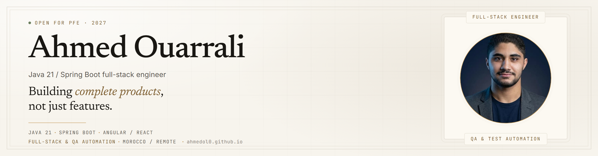

<p align="center">
  <a href="https://ahmedol0.github.io">
    
  </a>
</p>

<h1 align="center">Ahmed Ouarrali · Portfolio</h1>

<p align="center">
  <strong>Java 21 / Spring Boot full-stack engineer</strong><br>
  Open to a final-year engineering internship (PFE) · February-June 2027 · Morocco / Europe / remote
</p>

<p align="center">
  <a href="https://ahmedol0.github.io"></a>
  <a href="https://github.com/AhmedOL0/AhmedOL0.github.io/actions/workflows/deploy.yml"></a>
  
  
  
</p>

<p align="center">
  <a href="#featured-case-studies">Case studies</a> ·
  <a href="#quality-gates">Quality gates</a> ·
  <a href="#run-locally">Run locally</a> ·
  <a href="#contact">CVs and contact</a>
</p>

---

I'm Ahmed, a full-stack engineer focused on Java 21 and Spring Boot. I build and test end-to-end products, from backend contracts to the interface people use.

This repository is the source of my portfolio. It is not just a landing page: it is a set of engineering case studies with the role, architecture, testing evidence and trade-offs behind each project.

> `EN / FR` · `dark / light` · `7 projects` · `4 CVs` · `596 Playwright checks` · `4 browser profiles` · `0 cookies`

## What makes it different

- **Case studies with evidence**: each project opens a dossier with my role, architecture, approach, outcome, quality/testing details and screenshots. Case-study links are shareable through hashes.
- **Claims trace to the final CVs**: no invented metrics or demos. OdemLab's mobile app and AI diagnosis are explicitly labelled as teammates' work; my contribution was backend and web.
- **Crawlable without JavaScript**: a semantic static summary lives in `#root` with the name, projects, contact and CV links. A raw-HTML test protects it; React then replaces it with the interactive app.
- **Bilingual and accessible by construction**: one typed EN/FR copy source, synchronized `lang` and title, a French copy-leak test, skip link, focus states, reduced motion, 44px touch targets and layouts from 320px to desktop.
- **The test suite is part of the product**: 596 checks across Chromium, Firefox, WebKit and mobile Chrome cover content, accessibility (including axe-core serious/critical scans in light and dark), keyboard navigation, responsive layout, SEO, security headers, print and mobile journeys.
- **No UI component library**: only React, React DOM and web-vitals at runtime. Tailwind CSS v4 compiles the utilities; the dossier layer is hand-written in `src/index.css`.

## Featured case studies

| Project | My contribution | Stack | Case study |
| --- | --- | --- | --- |
| **OdemLab** · Zorium | Backend business modules and order flow; web storefront and back-office. Mobile app and AI diagnosis were teammates' work. | Spring Boot, Next.js/React, PostgreSQL/Redis, GCP | [Case study](https://ahmedol0.github.io/#case-odemlab) |
| **ProcureFlow** | Full-stack: multi-tenant requests, approvals, budgets, tenant isolation and the AI copilot. | Spring Boot, Angular, PostgreSQL/MongoDB, JWT | [Case study](https://ahmedol0.github.io/#case-procureflow) · [Repository](https://github.com/AhmedOL0/ProcureFlow) |
| **Smart Campus** | Mobile: QR room sheets, AR view, timetable, bookings, announcements and incidents across three roles. Team of four. | Flutter, Firebase/Firestore, ARCore/ARKit | [Case study](https://ahmedol0.github.io/#case-smart-campus) |

All seven projects are on the [live site](https://ahmedol0.github.io/#work).

## Quality gates

| Gate | What runs | Current |
| --- | --- | --- |
| Build | `tsc -b` and Vite production build | Pass |
| Lint | oxlint | Clean |
| E2E | Playwright across 4 browser profiles | 596 checks |
| Axe | Serious/critical WCAG violations, light + dark + CV menu | 0 |
| Lighthouse | Clean run, unthrottled | 100/100 |
| Lighthouse | Clean run, mobile throttled (Slow 4G + 4x CPU) | 89/100 · TBT 0 ms · CLS 0 |

**About Lighthouse and axe:** a normal Chrome profile includes extensions such as Bubble, ad blockers and GitHub utilities. They can add seconds of third-party JavaScript and make the audit look much worse than the site. Measure in Incognito with extensions disabled, or use a clean CLI profile. Lighthouse scores also depend on the throttle profile: this project reaches 100/100 unthrottled and 89/100 under Lighthouse's simulated mobile conditions. The live score can vary further with GitHub Pages TTFB. The axe scan runs in the Playwright accessibility spec against light, dark and the open CV menu.

## Run locally

```sh
git clone https://github.com/AhmedOL0/AhmedOL0.github.io.git
cd AhmedOL0.github.io
npm ci
npm run dev
```

| Script | Purpose |
| --- | --- |
| `npm run dev` | Vite dev server |
| `npm run build` | Strict type-check and production build |
| `npm run lint` | oxlint |
| `npm run test:e2e` | Full e2e suite against the preview build |
| `npm run test:e2e:ui` | Playwright UI mode |

For the e2e suite, install the browsers, build, then run Playwright. The config starts `vite preview` automatically:

```sh
npx playwright install
npm run build
npx playwright test --workers=4
```

## Engineering decisions

<details>
<summary>Why these choices</summary>

- **Static fallback inside `#root`, not SSR**: GitHub Pages gives static hosting; the fallback serves crawlers and no-JS visitors, while a raw-HTML test prevents regressions. React removes it only when the app mounts.
- **Case-study dialogs and hashes, not a router**: keeps a single-page bundle and shareable deep links without server rewrites. `#case-*` URLs open the relevant dossier.
- **One typed copy source**: `src/i18n-data.ts` drives the entire page. The language switch updates copy, `lang` and the document title; a test catches untranslated French.
- **Custom dossier layer instead of a component library**: fewer runtime dependencies and full control over responsive layout, focus states and the editorial visual language.
- **Claims audited against the final CVs**: team contributions are labelled; unverified metrics, demos and screenshots stay out.
</details>

## Project structure

<details>
<summary>Show the tree</summary>

```text
src/
  components/     hero, work and case-study dialogs, experience, contact, dock
  i18n-data.ts    EN/FR copy for every section
  i18n.tsx        language provider and switcher
  hooks.ts        reveal/active-section observers, progress, back-to-top, theme
  analytics.ts    GoatCounter events and web-vitals (idle-loaded)
  index.css       tokens, layout and the dossier styling layer
e2e/              Playwright specs (content, a11y, responsive, SEO, security, print)
public/           fonts, portraits, four CVs, portfolio.json, llms.txt, manifest
scripts/          OG image and README banner generators
index.html        metadata, preloads and the crawlable static summary
```

</details>

## Deployment

Pushes to `main` run `.github/workflows/deploy.yml`: type-check, lint, build, Chromium e2e smoke, then publish `dist/` to GitHub Pages. Pull requests run the same build and e2e gates without deploying.

## Contact

- **Live**: [ahmedol0.github.io](https://ahmedol0.github.io)
- **Email**: [ahmedouarrali12@gmail.com](mailto:ahmedouarrali12@gmail.com)
- **LinkedIn**: [ahmed-ouarrali](https://www.linkedin.com/in/ahmed-ouarrali)
- **GitHub**: [AhmedOL0](https://github.com/AhmedOL0)
- **CVs**: Full-Stack [EN](https://ahmedol0.github.io/assets/CV_Ahmed_Ouarrali_EN.pdf) / [FR](https://ahmedol0.github.io/assets/CV_Ahmed_Ouarrali_FR.pdf) · QA [EN](https://ahmedol0.github.io/assets/CV_Ahmed_Ouarrali_QA_EN.pdf) / [FR](https://ahmedol0.github.io/assets/CV_Ahmed_Ouarrali_QA_FR.pdf)

I'm looking for a **PFE internship (February-June 2027)** in backend, full-stack or QA automation, in Morocco or Europe, on-site or remote.

---

<p align="center"><sub>Built with React 19, TypeScript, Vite and Tailwind CSS. Deployed on GitHub Pages.</sub></p>
